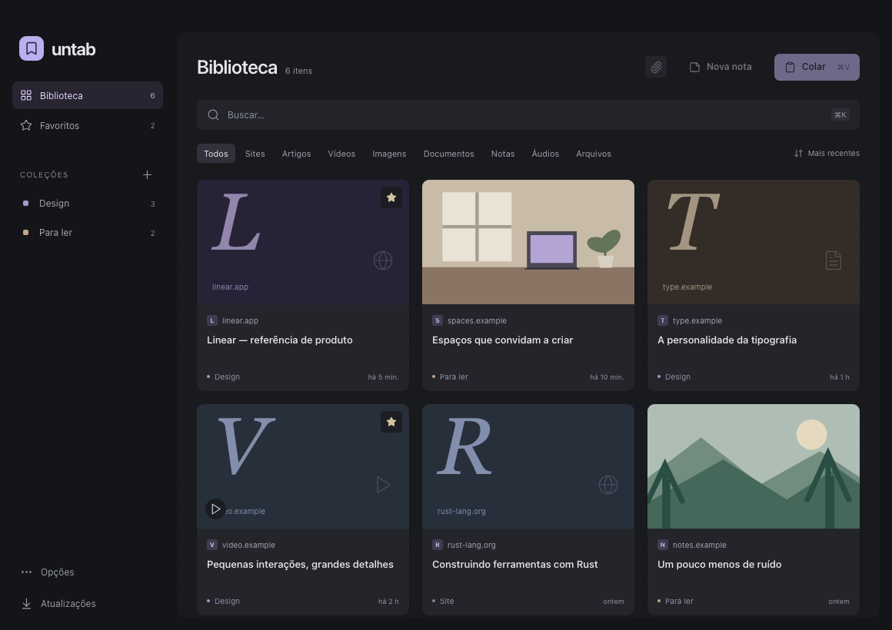

<div align="center">
  
  <h1>Untab</h1>
  <p>A quiet place for everything you want to keep.</p>
  <p>Links, notes, images and files. Paste once. Find them later.</p>
  <p>
    <a href="https://github.com/kiocos/untab/releases">Download</a> ·
    <a href="docs/installation.md">Installation</a> ·
    <a href="docs/usage.md">Guide</a> ·
    <a href="CONTRIBUTING.md">Contribute</a>
  </p>
  <p>
    <a href="LICENSE"></a>
    
    <a href="https://github.com/kiocos/untab/actions/workflows/ci.yml"></a>
  </p>
</div>



Untab is a small desktop library built with **Rust, Tauri and React**. Everything is stored on your computer in SQLite and ordinary files. No account, server or subscription. The interface is currently in Brazilian Portuguese.

## Keep it close

- **Paste to save** — `⌘V` on macOS, `Ctrl+V` on Windows and Linux. Links become bookmarks, text becomes notes, and copied files and images join your library.
- **Your files stay yours** — images, PDFs, video, audio and other documents are copied into the library. Moving the original won't break them.
- **Find things quickly** — grid and list views, search, collections, favorites and filters by type.
- **Useful previews** — website titles and covers, image previews and playback for compatible audio/video. Open saved files in their default app.
- **A way back** — deletion confirmation, undo and portable `.untab` backups including attachments.
- **Updates in the app** — signed updates for Windows, macOS and Linux AppImage, installed when you choose.

## Install

Download a package from [Releases](https://github.com/kiocos/untab/releases). You don't need Rust, Node or a terminal to use the Windows or macOS apps.

| System | Package | Requirements |
| --- | --- | --- |
| macOS | `.dmg`, universal | macOS 12+, Apple Silicon or Intel |
| Windows | `-setup.exe` | Windows 10/11, x64 |
| Linux | `.AppImage` or `.deb` | x64; Ubuntu 22.04+ or a compatible distribution |

The first release is **not Apple-notarized or Windows Authenticode-signed**. OS security prompts may appear. See the [installation guide](docs/installation.md) for first launch, updates and uninstalling.

## Run from source

Install Node.js 22 LTS, Rust 1.90+ and the [Tauri prerequisites](https://v2.tauri.app/start/prerequisites/) for your OS, then:

```sh
git clone https://github.com/kiocos/untab.git
cd untab
npm ci
npm run desktop
```

[Development and tests](docs/development.md) · [Release process](docs/releases.md) · [Changelog](CHANGELOG.md)

## Small by design

Untab saves bookmarks; it doesn't archive entire websites or download a video from its URL. Files are limited to 2 GB each, and executables, installers and scripts are rejected. PDF/video thumbnails are currently available on macOS; other platforms use file cards. Media playback depends on the OS codecs. Linux WebKitGTK may require opening local audio/video in your system player.

Saving and searching work offline. Website previews contact the saved website; update checks contact GitHub. There is no analytics or cloud sync. [Storage and privacy](docs/usage.md#storage-and-privacy).

Contributions are welcome, especially bug fixes and platform compatibility. Please keep changes focused. Inspired by the calm workspace of T3 Code and Excalidraw, and the presentation of [Linkwarden](https://github.com/linkwarden/linkwarden).

[MIT](LICENSE) © Caio. [Third-party notices](THIRD_PARTY_NOTICES.md).
